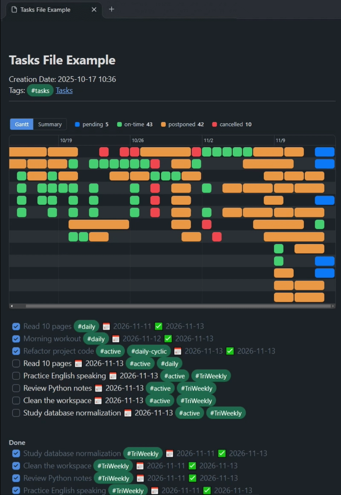
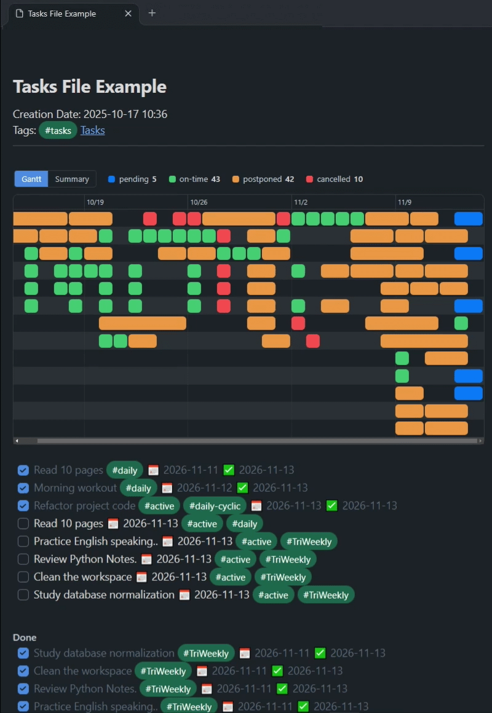

 <p align="center">
  
</p>

<h1 align="center">Taskscape</h1>

<p align="center">
  <strong>See your tasks in a different perspective.</strong><br>
  Turn your Markdown task lists into interactive Gantt timelines and grouped summaries, right inside Obsidian.
</p>

<p align="center">
  <a href="#usage">Usage</a> •
  <a href="#views">Views</a> •
  <a href="#task-format">Task Format</a> •
  <a href="#works-well-with-clockwork-tasks">Clockwork Tasks</a> •
  <a href="#installation">Installation</a>
</p>

***

Taskscape reads a task file in your vault, works out how long each task stayed open, and draws it. It is useful for habit and self-improvement task lists where you want to see what repeats, what slipped, and how long things took.

## Usage

Add a `taskscape` code block to any note:

````
```taskscape
source: TODO/Self Improve Tasks.md
```
````

With only `source`, every task and every date is shown. **All other lines are optional**:

| Parameter | What it does | Default |
| --- | --- | --- |
| `source` | Path of the task file in your vault (with or without `.md`), or a `[[wikilink]]` | required |
| `view` | `gantt` or `summary` | `gantt` |
| `count` | Show only the last N tasks (**Gantt view only**) | all |
| `start` | Only tasks on or after this date (`YYYY-MM-DD`) | oldest task |
| `end` | Only tasks on or before this date (`YYYY-MM-DD`) | latest task |

```taskscape
source: TODO/Self Improve Tasks.md
view: summary
start: 2026-09-01
end: 2026-09-30
```

Dates are matched against a task's done date, or its due date if it has no done date. `count` keeps the last N tasks after the date filter is applied.

## Views

### 1. Gantt View

*Gantt* draws one bar per task from its due date to its done date (or to today if it is still open).

Visualize your tasks on a timeline, track when tasks were due, when they were completed, and which ones are still pending.

> [!TIP]
> Great for spotting patterns in your daily routine and getting a feel for your current rhythm.



- Bars are packed into the fewest possible lanes, and tasks with the same name stay on the same lane *when possible*.
- Hover a bar to see the full task name, dates, state and tags.
- The chart opens scrolled to the latest dates.

### 2. Summary View

*Summary* groups repeating tasks into one row each:

> Workout legs **×3** 🚀 2026-10-23 🏁 2026-10-26

You'll see grouped overview of recurring tasks, how often tasks appear, their date ranges, and their completion states at a glance.

> [!TIP]
> Perfect for looking back at your progress and seeing how far you've come.




- ×N is how many times the task appears, 🚀 is its earliest done date and 🏁 is its latest done date (`open` if none is done).
- Rows are sorted by name and end with small counts per state.
- **Group similar** (beta) merges tasks whose names differ only slightly, such as "Workout legs" and "Workout - legs". It is off by default. Merged rows show a "variants" hint listing the original names.

The note **updates automatically** a moment after you save the task file.

## Task Format

Taskscape reads lines in the emoji task format used by the Tasks plugin:

```
- [ ] Read a chapter #reading 📅 2026-10-01
- [x] Workout #daily 📅 2026-10-01 ✅ 2026-10-01
- [-] Call the bank 📅 2026-10-02 ❌ 2026-10-03
```

A task's state comes from its dates and markers:

| State | Meaning |
| --- | --- |
| 🔵 pending | No ✅ or ❌ date |
| 🟢 on-time | 📅 date = ✅ date |
| 🟡 postponed | 📅 date ≠ ✅ date  |
| 🔴 cancelled | has a ❌ date |

<details>
<summary>Task Icons Corrispond to...</summary>
✅ Done date
❌ Cancel date
📅 Due date
</details>

> [!CAUTION]
> **Nested Tasks**
> 
> Only top-level task lines (`- [ ] ...`) are read. Indented sub-tasks are ignored.


## Works well with [Clockwork Tasks](https://community.obsidian.md/plugins/clockwork-tasks)


Creating recurring tasks by hand takes time. [Clockwork Tasks](https://community.obsidian.md/plugins/clockwork-tasks), another Obsidian plugin by me, lets you write your routines once and automatically generate their tasks each day.

Taskscape can visualize the tasks Clockwork Tasks creates, so you can build a routine and see your progress over time.

As a personal recommendation, keep daily tasks small—around 5–20 minutes. Schedule more demanding tasks two or three times a week, and consider adding days off. Find the pace that works for you: **your life, your pace**.

## Installation

From the Community plugins browser: search for **Taskscape**, install and enable.

Manually: download `main.js`, `manifest.json` and `styles.css` from the latest release, put them in `<your vault>/.obsidian/plugins/taskscape/`, then reload and enable the plugin.

<details>
<summary>Building from source</summary>

1. Clone the repository and open its directory.
2. Install the dependencies with `npm ci`.
3. Build the plugin with `npm run build`.
4. Copy the generated `main.js`, along with `manifest.json` and `styles.css`, into `<your vault>/.obsidian/plugins/taskscape/`.

</details>

## Privacy

Taskscape makes no network requests, collects no telemetry, and only reads the task file named in the code block.

## License

[MIT](LICENSE)
